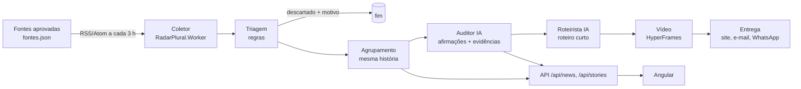

# Como o Coreletter funciona — guia da equipe

Este guia explica **cada parte** do Coreletter e **por que** ela é assim. Para a decisão formal, veja `docs/decisoes/`. Se você vai mexer numa etapa, leia a seção dela antes.

## Visão geral



| # | Etapa | Estado | Onde está o código | Decisão |
|---|---|---|---|---|
| 1 | Coletor | **Pronto** | `backend/RadarPlural.Worker`, `backend/RadarPlural.Ingestion` | 0002 |
| 2 | Triagem por regras | Em PR | `RadarPlural.Ingestion/Triage*` | 0003 |
| 3 | Agrupamento | Em PR | `RadarPlural.Ingestion/StoryClustering*` | 0003 |
| 4 | Auditor | Contrato pronto (B04), código B05/B09 | — | 0003, `contratos/comparacao-v1.md` |
| 5 | Roteirista | Discussão | — | 0003 |
| 6 | Vídeo (HyperFrames) | Discussão / prova de conceito | — | 0003 |
| 7 | Entrega | Discussão | — | 0003 |

## A regra de ouro: estado no banco, não agente chamando agente
Cada etapa **lê** os itens que estão no estado anterior, faz seu trabalho e **grava** o novo estado:

```
FeedItem: coletado → triado | descartado(motivo)
Historia: agrupada → auditada → roteirizada → video_pronto → publicada
```

**Por quê:** se a IA ou a plataforma de vídeo cair no meio, nada se perde: o item fica parado e é retomado na próxima execução. Também fica fácil ver no banco onde cada notícia está, e cada etapa pode virar um pod separado no Kubernetes depois.

## Portas e adaptadores (aula de 11/11, notas em `docs/AULAS.md`)
Cada etapa é uma **interface** (porta). A implementação concreta é um **adaptador** que pode ser trocado sem mexer no resto:

| Porta | Adaptador simulado (demo, testes) | Adaptador real |
|---|---|---|
| `IAuditor` | Respostas fixas dos exemplos do contrato | Gemini |
| `IRoteirista` | Roteiro montado por template | Gemini |
| `IGeradorVideo` | Gera só o HTML da composição | HyperFrames (`npx hyperframes render`) |
| `IEntregador` | Grava em arquivo/log | E-mail, WhatsApp, Telegram |

**Por quê:** a apresentação precisa funcionar **sem internet e sem chave** (B10); os testes não podem depender de IA real; e trocar o Gemini por outro modelo não pode exigir reescrever o domínio.

---

## 1. Coletor
- Lê só feeds RSS/Atom das fontes em `fontes.json`. Não raspa HTML.
- Guarda **título, link, data e trecho de até 300 caracteres**. O texto completo fica no site de origem (direito autoral).
- Roda pelo GitHub Actions a cada 3 h; à mão: `dotnet run --project backend/RadarPlural.Worker -- --dry-run`.
- Segurança: lista fechada de hosts, IP checado na conexão (SSRF), 2 MB, 15 s, XML sem DTD. Detalhes em `decisoes/0002-ingestao.md`.

## 2. Triagem (regras, sem IA)
Descarta o que não é notícia ou não serve para comparar, **gravando o motivo**:
- conteúdo de afiliado/promoção (ex.: caminho `/achados/` no Tecnoblog, configurado por fonte em `fontes.json`);
- título caça-clique (padrões fixos e testados);
- notícia publicada há mais de 7 dias.

**Por que regra e não IA:** custo zero, roda em tudo, cada regra tem teste e dá para explicar exatamente por que algo foi descartado.

## 3. Agrupamento (mesma história, veículos diferentes)
Junta notícias de **fontes diferentes** sobre o mesmo acontecimento, numa janela de 48 h, comparando as palavras importantes das manchetes (sem acentos, sem palavras vazias como "de", "para", "como").

**Por quê:** é a base de tudo o que vem depois. Corroboração = quantos veículos independentes deram a história. O auditor só compara dentro de uma história.

**Limite conhecido:** manchetes muito diferentes sobre o mesmo fato podem não se juntar, e assuntos diferentes com palavras parecidas podem se juntar. O limiar é ajustável e foi medido com notícias reais.

## 4. Auditor (IA)
Recebe as notícias de uma história e devolve, no formato do contrato `contratos/comparacao-v1.md`:
- afirmações em linguagem neutra;
- quem concorda, quem diverge, o que só uma fonte diz;
- **citação literal** de cada fonte como evidência;
- limitações.

**Nunca** dá nota de verdade. Um **validador em código** confere que toda citação existe de fato no texto da fonte; o que não confere é descartado.

## 5. Roteirista (IA)
Recebe **só o JSON validado do auditor**, nunca a matéria. Escreve um roteiro curto (até ~60 s): cenas com texto e as afirmações que cada cena usa.

**Por que separado do auditor:** o texto de notícia é dado não confiável. Se o mesmo agente lesse a matéria e escrevesse o roteiro, uma frase maliciosa poderia "dar ordens" ao roteiro. Separando, o roteirista nunca vê esse texto.

## 6. Vídeo (HyperFrames)
- HyperFrames transforma **HTML + CSS + animações** em MP4 (Chrome headless + FFmpeg). Código aberto (Apache 2.0), roda local, em Docker ou CI.
- Nosso adaptador **gera o HTML a partir de um modelo da marca**, colocando o texto do roteiro **escapado**, e chama `npx hyperframes render`.
- **Um vídeo por história**, reaproveitado por todos os clientes do tema. O cliente recebe a **seleção** dos vídeos dos temas dele.
- Sempre com legenda, aviso "gerado por IA a partir de N fontes" e lista de fontes.

## 7. Entrega
Resumo por cliente conforme plano e temas (#13): site sempre; e-mail, WhatsApp e Telegram no Plus. Publicação no YouTube fica para depois do TCC.

---

## Kubernetes: onde entra
O professor sugeriu começar por um cluster simples (API "hello world", dois pods conversando). Notas completas das aulas e a avaliação "o Coreletter comporta Kubernetes?" em `docs/AULAS.md`. Conceitos da aula de 09/11 aplicados aqui:

| Conceito | No Coreletter |
|---|---|
| **Cluster** = conjunto de máquinas (nodes) comandado pelo **control plane** | O ambiente onde tudo roda |
| **Pod** = a "travessa" onde o container roda (pode ter mais de um container) | Um pod da API, um pod de worker etc. |
| **Ciclo de reconciliação**: observa → compara com o desejado → cria/remove pods | Se o worker de auditoria cair, o Kubernetes sobe outro sozinho |
| **Scheduler** decide em qual node cada pod roda | Render de vídeo (pesado) pode ir para um node com mais CPU |

Mapa para quando cada etapa estiver pronta: API = `Deployment` + `Service`; coletor = `CronJob`; triagem/agrupamento/auditoria/roteiro = `Deployment` de worker; render = `Job`; PostgreSQL fora do cluster (gerenciado).

## Glossário rápido
- **História:** grupo de notícias de veículos diferentes sobre o mesmo acontecimento.
- **Corroboração:** número de fontes independentes numa história.
- **Adaptador simulado:** implementação falsa e previsível de uma porta, para demo e testes.
- **SSRF:** ataque em que o servidor é induzido a acessar endereços internos.
